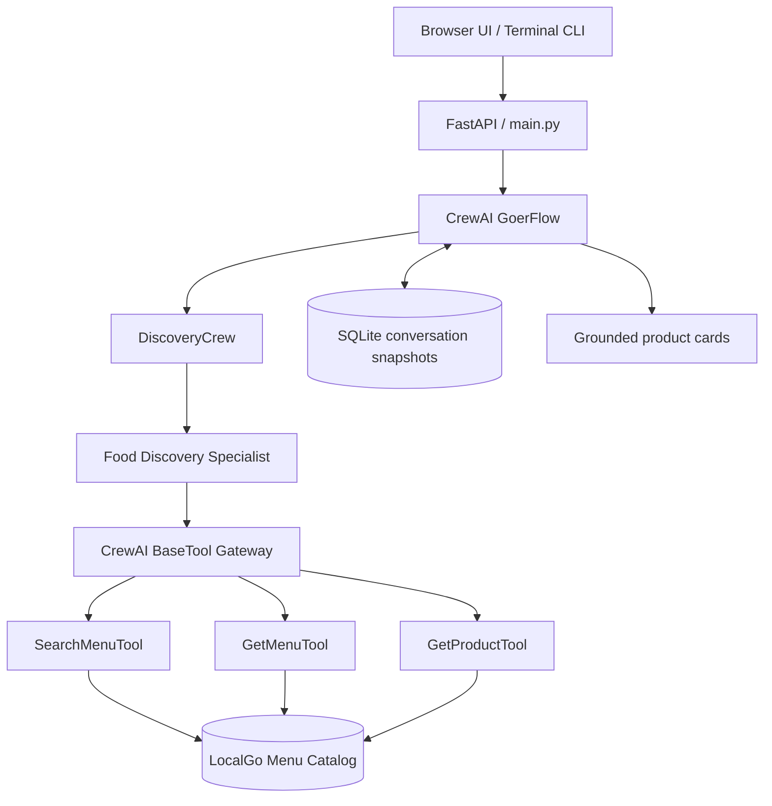

# Goer AI

**A conversational restaurant menu assistant built with CrewAI Flow, typed tools, and FastAPI.**

Goer turns natural-language requests into searches over a structured restaurant catalog. Ask for a specific food, browse a merchant's menu, or ask for recommendations. The assistant coordinates food discovery using a stateful CrewAI Flow, a specialized discovery agent, and typed CrewAI tools operating over a bundled catalog snapshot of **138 products across local merchants** (Al-Taib and Château Kabab).

## Architecture



| Component | Implementation |
| --- | --- |
| Runtime | Python 3.10–3.13 (`uv` managed) |
| Framework | CrewAI Flow + CrewAI Agent / Task (`crewai[tools]==1.14.4`) |
| Model Configuration | Configured via `MODEL` and `OPENAI_API_KEY` (defaults to `openai/gpt-4.1-mini`) |
| Tools | Typed `BaseTool` subclasses (`SearchMenuTool`, `GetMenuTool`, `GetProductTool`) with Pydantic validation |
| Web API & UI | FastAPI, Uvicorn, and HTML/CSS browser chat interface |
| Catalog | Bundled local JSON snapshot with product IDs, merchant IDs, and integer prices in cents |

## Getting Started

### 1. Requirements

- Python 3.10, 3.11, 3.12, or 3.13
- [`uv`](https://docs.astral.sh/uv/) package manager
- OpenAI API key (or another CrewAI-supported provider)

### 2. Install dependencies

From the repository root:

```powershell
$env:UV_LINK_MODE = "copy"
uv sync
```

### 3. Configure environment variables

Copy the template:

```powershell
Copy-Item .env.example .env
```

Set your model credentials in `.env`:

```dotenv
OPENAI_API_KEY=your_openai_api_key_here
MODEL=openai/gpt-4.1-mini
```

The `.env` file is ignored by Git and should never be committed.

## Running Goer

### Interactive Terminal CLI

Run the interactive terminal chat loop:

```powershell
uv run goer
```

*(You can also run `uv run kickoff --interactive` or `uv run python src/goer_localgo/main.py --interactive`)*

Type your questions at the prompt:

```text
You: Find me a sandwich at Al-Taib.
Goer: Thinking...
Goer: Here are sandwiches available at Al-Taib: ...
```

Type `exit` or `quit` to exit the session. Follow-up messages share one
conversation, including the last displayed product IDs and six recent exchanges.
If the local `uv` launcher fails, use
`uv run python src/goer_localgo/main.py --interactive`.

### One-shot Flow Kickoff

Run the default turn:

```powershell
uv run kickoff
```

### Browser Chat UI and FastAPI Server

Start the FastAPI server:

```powershell
uv run python -m uvicorn goer_localgo.api.main:app --reload
```

Open [http://127.0.0.1:8000](http://127.0.0.1:8000) for session-aware chat with
product cards. Try “Show Al-Taib's menu”, then “Tell me about the second one”.
Use **New chat** to start over.

**Development only:** conversation routes currently use a shared demo identity;
legacy client-supplied user IDs are not authentication. JWTs are not implemented.
Do not deploy with real customer data yet.

Conversation snapshots persist in `~/.localgo/goer/conversations.sqlite3`.
Set `GOER_CONVERSATION_DB` to an absolute path to override it. Tests use
isolated temporary databases.

### REST API Endpoints

- `GET /health`: service health check
- `POST /v1/conversations`: create a conversation, returning its ID (201).
- `POST /v1/conversations/{id}/turns`: send `{"message":"..."}` and receive
  text, product cards, conversation/turn IDs, and action metadata.
- `POST /v1/chat`: backward-compatible text endpoint; optionally pass
  `conversation_id` to continue an existing session:
  ```powershell
  Invoke-RestMethod `
    -Uri http://127.0.0.1:8000/v1/chat `
    -Method Post `
    -ContentType "application/json" `
    -Body '{"message":"Find me a sandwich at Al-Taib."}'
  ```
- `POST /api/chat`: legacy alias supporting message-history request envelopes;
  only the latest user message is consumed. History lives on the server.

Both legacy endpoints preserve `user_id` and `message` response fields and add
`conversation_id`, `cards`, and `actions`. Missing conversations return 404;
concurrent snapshot conflicts return 409.

## Testing

### Automated Test Suite

Run unit and integration tests:

```powershell
uv run python -m pytest tests -v
```

The suite is offline and uses a deterministic stub model. Browser-script tests
run with Node when available; no browser framework or npm dependencies are needed.

### Tool Smoke Tests

Verify catalog operations deterministically without sending model requests:

```powershell
uv run python src/goer_localgo/tools/try-out-tools/get_menu_smoke.py
uv run python src/goer_localgo/tools/try-out-tools/search_menu_smoke.py
uv run python src/goer_localgo/tools/try-out-tools/get_product_smoke.py
```

## Repository Structure

```text
goer-ai/
├── src/
│   └── goer_localgo/
│       ├── api/
│       │   └── main.py          # FastAPI app and web endpoints
│       ├── crews/
│       │   └── discovery_crew/  # CrewAI discovery agent and task definitions
│       │       ├── config/
│       │       │   ├── agents.yaml
│       │       │   └── tasks.yaml
│       │       └── discovery_crew.py
│       ├── domain/
│       │   ├── catalog.py       # Cached catalog repository
│       │   ├── cards.py         # Turn-local collection and grounded cards
│       │   └── conversations.py # Owned SQLite snapshots and revisions
│       ├── flow/                # Context loading, discovery, response assembly
│       ├── schemas/             # Validated response envelopes and cards
│       ├── tools/
│       │   ├── catalog_tools.py # CrewAI BaseTool implementations
│       │   └── try-out-tools/   # Standalone per-tool smoke tests
│       ├── web/
│       │   ├── index.html       # Browser chat interface
│       │   └── chat.js          # Sessions and safe card rendering
│       ├── data_menu.json       # Bundled LocalGo restaurant catalog
│       └── main.py              # Thin CLI entry points
├── tests/
│   ├── unit/                    # Catalog tools and Pydantic schema validation
│   └── integration/             # FastAPI endpoints and route validation
├── docs/
│   ├── localgo-delivery-architecture-plan.md # Authoritative roadmap
│   └── project-context-and-next-steps.md    # Current implementation handoff
├── pyproject.toml               # Project metadata, dependencies, and entrypoints
├── uv.lock                      # Pinned dependency lockfile
├── .env.example                 # Configuration template
└── AGENTS.md                    # Agent coordination log
```

## Architecture Roadmap

The target is a modular monolith with a router and four scoped specialists,
only one running per turn. Discovery is implemented; cart, checkout, and
order/support are future work. Deterministic services own transactional state,
and final order/payment confirmation must use explicit direct actions.

See [the authoritative plan](docs/localgo-delivery-architecture-plan.md) and
[the current handoff](docs/project-context-and-next-steps.md).
