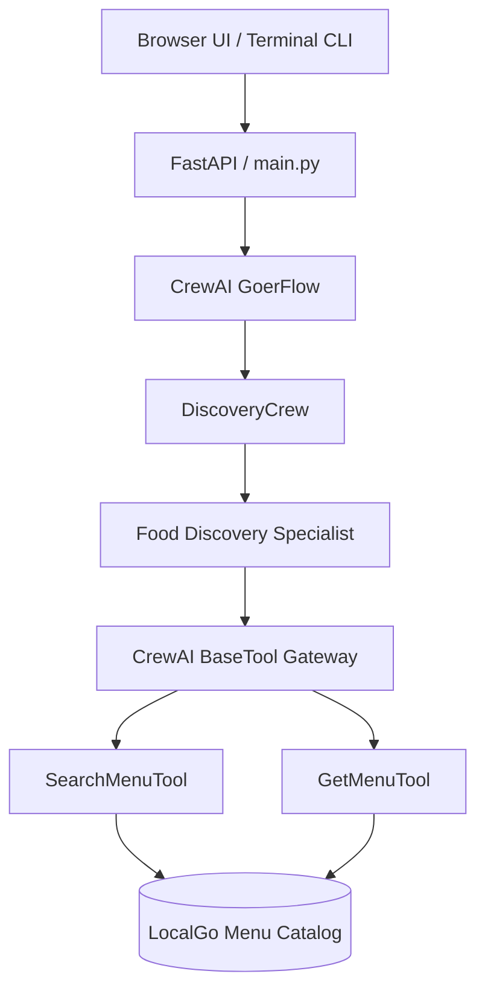

# Goer AI

**A conversational restaurant menu assistant built with CrewAI Flow, typed tools, and FastAPI.**

Goer turns natural-language requests into searches over a structured restaurant catalog. Ask for a specific food, browse a merchant's menu, or ask for recommendations. The assistant coordinates food discovery using a stateful CrewAI Flow, a specialized discovery agent, and typed CrewAI tools operating over a bundled catalog snapshot of **138 products across local merchants** (Al-Taib and Château Kabab).

## Architecture



| Component | Implementation |
| --- | --- |
| Runtime | Python 3.10–3.13 (`uv` managed) |
| Framework | CrewAI Flow + CrewAI Agent / Task (`crewai[tools]==1.14.4`) |
| Model Configuration | Configured via `MODEL` and `OPENAI_API_KEY` (defaults to `openai/gpt-4.1-mini`) |
| Tools | Typed `BaseTool` subclasses (`SearchMenuTool`, `GetMenuTool`) with Pydantic validation |
| Web API & UI | FastAPI, Uvicorn, and HTML/CSS browser chat interface |
| Catalog | Bundled local JSON snapshot with product IDs, merchant IDs, and integer prices in cents |

## Getting Started

### 1. Requirements

- Python 3.10, 3.11, 3.12, or 3.13
- [`uv`](https://docs.astral.sh/uv/) package manager
- OpenAI API key (or another CrewAI-supported provider)

### 2. Install dependencies

From the repository root:

```powershell
$env:UV_LINK_MODE = "copy"
uv sync
```

### 3. Configure environment variables

Copy the template:

```powershell
Copy-Item .env.example .env
```

Set your model credentials in `.env`:

```dotenv
OPENAI_API_KEY=your_openai_api_key_here
MODEL=openai/gpt-4.1-mini
```

The `.env` file is ignored by Git and should never be committed.

## Running Goer

### Interactive Terminal CLI

Run the interactive terminal chat loop:

```powershell
uv run goer
```

*(You can also run `uv run kickoff --interactive` or `uv run python src/goer_localgo/main.py --interactive`)*

Type your questions at the prompt:

```text
You: Find me a sandwich at Al-Taib.
Goer: Thinking...
Goer: Here are sandwiches available at Al-Taib: ...
```

Type `exit` or `quit` to exit the session.

### One-shot Flow Kickoff

Run the default turn:

```powershell
uv run kickoff
```

### Browser Chat UI and FastAPI Server

Start the FastAPI server:

```powershell
uv run uvicorn goer_localgo.api.main:app --reload
```

Open [http://127.0.0.1:8000](http://127.0.0.1:8000) in your browser for the web chat UI.

### REST API Endpoints

- `GET /health`: service health check
- `POST /v1/chat`: API endpoint for direct agent prompts:
  ```powershell
  Invoke-RestMethod `
    -Uri http://127.0.0.1:8000/v1/chat `
    -Method Post `
    -ContentType "application/json" `
    -Body '{"message":"Find me a sandwich at Al-Taib."}'
  ```
- `POST /api/chat`: browser chat UI endpoint supporting message history envelopes.

## Testing

### Automated Test Suite

Run unit and integration tests:

```powershell
uv run pytest tests -v
```

### Tool Smoke Tests

Verify catalog operations deterministically without sending model requests:

```powershell
uv run python src/goer_localgo/tools/try-out-tools/get_menu_smoke.py
uv run python src/goer_localgo/tools/try-out-tools/search_menu_smoke.py
```

## Repository Structure

```text
goer-ai/
├── src/
│   └── goer_localgo/
│       ├── api/
│       │   └── main.py          # FastAPI app and web endpoints
│       ├── crews/
│       │   └── discovery_crew/  # CrewAI discovery agent and task definitions
│       │       ├── config/
│       │       │   ├── agents.yaml
│       │       │   └── tasks.yaml
│       │       └── discovery_crew.py
│       ├── domain/
│       │   └── catalog.py       # Catalog query logic and models
│       ├── tools/
│       │   ├── catalog_tools.py # CrewAI BaseTool implementations
│       │   └── try-out-tools/   # Standalone per-tool smoke tests
│       ├── web/
│       │   └── index.html       # Browser chat interface
│       ├── data_menu.json       # Bundled LocalGo restaurant catalog
│       └── main.py              # CrewAI Flow definition & CLI entry points
├── tests/
│   ├── unit/                    # Catalog tools and Pydantic schema validation
│   └── integration/             # FastAPI endpoints and route validation
├── docs/
│   └── goer-agentic-architecture-plan.md  # Multi-agent architecture roadmap
├── pyproject.toml               # Project metadata, dependencies, and entrypoints
├── uv.lock                      # Pinned dependency lockfile
├── .env.example                 # Configuration template
└── AGENTS.md                    # Agent coordination log
```

## Architecture Roadmap

The multi-agent design for cart, checkout, payments, and order fulfillment is described in [docs/goer-agentic-architecture-plan.md](docs/goer-agentic-architecture-plan.md).
