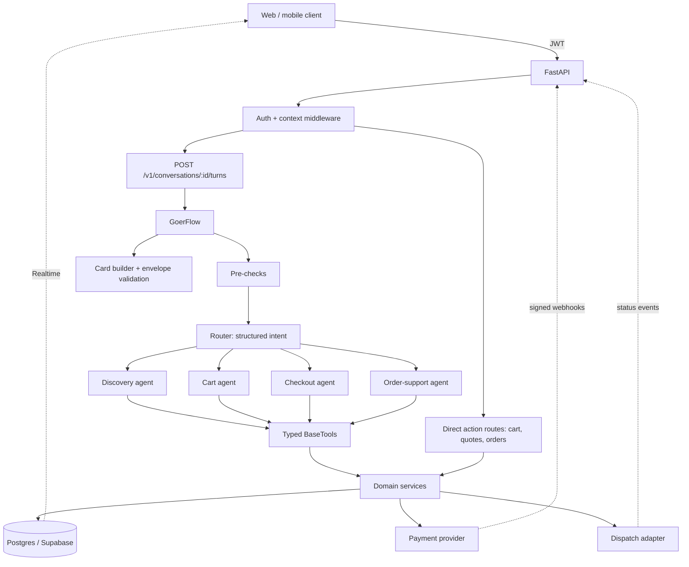
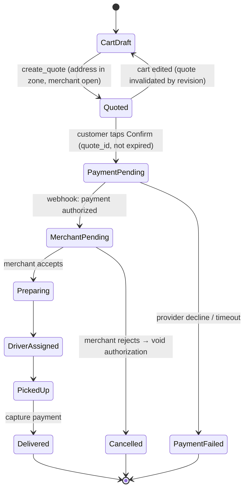

# Goer × LocalGo: Delivery App Architecture Plan

> **Status:** authoritative plan, updated 2026-11-04. Phase 0 is complete;
> Stateful discovery and all five cart integration milestones are implemented
> in code behind closed-by-default flags. Live SQL/auth/native/payment validation
> and broader discovery improvements remain. It supersedes
> `goer-agentic-architecture-plan.md` and
> `crewai-fastapi-localgo-architecture-plan.md`. Those files are kept for
> history only.

## 1. Goal

Turn Goer from a stateless menu-search chatbot into the conversational ordering
layer of **LocalGo**, a local restaurant delivery app. Customers should be able
to discover food, build a cart, check out, pay, and track or get support for
orders, all through one assistant. Every price, cart line, payment, and order
state must stay under deterministic backend control.

**Shape:** LocalGo remains the modular-monolith domain backend, with Postgres
(Supabase) as the cart/payment/order system of record. Goer is a separate
FastAPI conversational service/repository that calls LocalGo; it does not own
a duplicate cart. Its development conversation/turn journal uses durable SQLite.

---

## 2. Where we are today (verified against the code)

| Area | Current state | Gap to fix |
|---|---|---|
| Flow | Guest Discovery Flow; authenticated coordinator with classification, immutable planning, execution, and durable replay | SQLite journal requires one shared durable file; multi-host persistence remains future work |
| Agents | Discovery and read-only Cart planner; Python executes persisted cart writes | Checkout/order/support model specialists are not implemented |
| Tools | Catalog tools plus five individually filed cart tools; request-private credentials | Restaurant/category tools and broader/fuzzy search remain pending |
| Catalog | Authenticated turns use LocalGo's canonical 145-product snapshot; guest/demo uses 138-product fixture | No stock feed, real hours/zones, or option selections |
| API | Verified LocalGo sessions, owned conversations, stable request IDs, 202 pending recovery, grounded cart cards | Staging Auth/RLS verification and history retention/deletion are production gates |
| Clients | Flagged mobile server cart, signed-in Goer chat, stable checkout recovery; guest browser/CLI retained | Native SDK, real model, and sandbox end-to-end scenarios remain manual |
| Tests | 127 Goer tests, 116 backend tests, 8 tool smoke scripts, browser/mobile Node checks, mobile type check | Supabase/Stripe/model calls are mocked; SQL syntax parsed, not executed |

**Conclusion:** the five integration milestones are coded but not live-activated.
Follow the [activation/recovery runbook](cart-integration-runbook.md) and staging
checks before enabling the flags.

---

## 3. Core design decisions

### D1. Two paths into the domain: *chat turns* and *direct actions*

This is the most important decision for a delivery app.

```text
                   ┌─────────────── Chat turn (LLM) ───────────────┐
Customer text ───▶ │ Guard → Router → Specialist agent → tools     │──┐
                   └───────────────────────────────────────────────┘  │
                                                                      ▼
                                                            Domain services ──▶ Postgres
                                                                      ▲
Card button tap ─▶ Direct action API (no LLM) ────────────────────────┘
("Add to cart", "Confirm $34.12 order")
```

- **Language understanding** ("something spicy under $15 from Château Kabab")
  goes through the LLM.
- **Commitments** (add this exact item with these options, confirm this exact
  quote, cancel this order) can go through **typed REST actions** fired from
  cards, with no LLM involved. This makes them fast, cheap, and impossible for
  the model to mangle.
- The agent may *propose* mutations (for example, add to cart from chat), but
  **order placement and payment always require a direct action** that carries
  the `quote_id`. The model can never place an order on its own.

### D2. A cheap router, then one focused specialist per turn

Running a full multi-agent `Crew` on every turn is too slow and expensive for
chat. Each turn does the following:

1. **Deterministic pre-checks** (Python): size/rate limits, block card numbers
   and CVVs, and short-circuit action payloads.
2. **Router**: one structured LLM call that returns an
   `Intent(discovery | cart | checkout | order_support | smalltalk | handoff)`
   plus extracted slots. It uses a small, fast model.
3. **One specialist**: a single CrewAI `Agent` with only its own tools and a
   bounded `max_iter`.
4. **Response assembly** (Python): build cards from *tool results*, not from
   model prose, and validate the envelope.

Start with **one model for everything**. Split models only after evals show a
cost or latency win.

### D3. The server owns state; the model gets a compact snapshot

The model never holds cart or order truth. Each turn, the Flow loads a
**context snapshot** and passes it to the agent:

```text
cart: 2 lines, Al-Taib, subtotal $27.50 (rev 4)
active_order: none
last_shown_products: [chicken-shawarma, falafel-wrap, ...]   # resolves "those"/"the second one"
recent_turns: last 6 turns + rolling summary
```

### D4. Money is integer cents, end to end

Catalog, cart lines, option deltas, quotes, and orders all store integer
`*_cents` values with an ISO currency (`CAD`; normalize the current lowercase
`"cad"`). Formatting happens once, in Python, when cards are built. The LLM
never adds numbers.

### D5. Single-merchant carts (v1)

A cart belongs to one merchant. If the customer adds an item from another
merchant, they get a "start a new cart?" confirmation. This is standard delivery
UX and greatly simplifies quotes, dispatch, and fees.

---

## 4. Target runtime architecture



---

## 5. Repository layout (target)

This extends the current `src/goer_localgo/` tree. New items are marked `+`.

```text
src/goer_localgo/
  main.py                      # CLI entry points only (thin)
+ flow/
+   goer_flow.py               # GoerFlow: state, router, specialist dispatch, limits
+   state.py                   # GoerState, ContextSnapshot, Intent
    # Conversation persistence lives behind domain/conversations.py repositories.
  crews/
    discovery_crew/            # existing (becomes discovery specialist)
+   cart_crew/
+   checkout_crew/
+   support_crew/
  tools/
    catalog_tools.py           # existing; add get_product, list_restaurants
+   cart_tools.py
+   checkout_tools.py
+   order_tools.py
    try-out-tools/             # one smoke test per tool (Rule 4)
  domain/
    catalog.py → catalog/      # repository interface + JSON and Postgres impls
+   cart/  checkout/  orders/  conversations/  money.py
+ schemas/                     # Pydantic: chat envelope, cards, actions, domain DTOs
+ integrations/
+   supabase.py  payments.py  dispatch.py
  api/
    main.py                    # app factory, middleware
+   routes/  chat.py  catalog.py  cart.py  checkout.py  orders.py  webhooks.py
  web/index.html               # renders known card types
tests/
  unit/  integration/
+ evals/                       # golden conversations scored offline
```

**Layering rule:** `api` and `tools` call `domain`, and `domain` calls
`integrations`. Domain code never imports CrewAI, and tools contain no business
logic. They validate arguments, call a service, and serialize compactly.

---

## 6. GoerFlow design

```python
class GoerState(BaseModel):
    conversation_id: str             # stable application session ID; Flow adds a separate execution id
    user_id: str                     # from JWT, never from the prompt
    turn: TurnInput | None
    intent: Intent | None
    snapshot: ContextSnapshot | None
    recent_turns: list[TurnSummary]  # capped (e.g. 6) + rolling summary
    last_shown_product_ids: list[str]
    response: ChatEnvelope | None
```

```text
@start  load_context      → load snapshot (cart, active order, recent turns)
@listen precheck          → deterministic guards; may short-circuit with a refusal
@router route_intent      → "discovery" | "cart" | "checkout" | "support" | "smalltalk"
@listen("discovery")  run_discovery   ┐
@listen("cart")       run_cart        │ each: Agent.kickoff with scoped tools,
@listen("checkout")   run_checkout    │ inputs = message + snapshot
@listen("support")    run_support     ┘
@listen(or_(...))     compose_response → build cards from tool results, validate, persist turn
```

**Limits per turn:** at most one specialist, `max_iter` around 4, about 6 tool
calls, a wall-clock timeout of about 20 seconds, and an output size cap. If a
limit is hit, return a graceful "I couldn't finish that; here's what I found"
response with partial cards.

**Persistence (updated decision):** keep application `conversation_id` separate
from CrewAI's generated execution `id`. The pinned `1.14.4` does not expose the
newer `restore_from_state_id` kickoff API. Rather than couple sessions to
version-specific checkpoints, `domain/conversations.py` owns bounded snapshots
behind `ConversationRepository`. The development SQLite implementation saves
only after response assembly, with owner-scoped reads and compare-and-swap
revisions (conflicting turns return HTTP 409). Production replaces it with a
Postgres repository. `GOER_CONVERSATION_DB` overrides the default
`~/.localgo/goer/conversations.sqlite3`. Checkpoints, if added, remain separate
from durable application sessions.

**Tool results feed cards:** tools write their structured results into a
per-turn collector, and `compose_response` builds cards from that collector.
The client therefore shows exact catalog and cart data even if the model's
prose is imperfect.

---

## 7. Specialists and tool allowlists

| Specialist | Read tools | Mutation tools | Never allowed |
|---|---|---|---|
| Discovery | `list_restaurants`, `search_menu`, `get_menu_categories`, `get_product` | none | cart/order writes |
| Cart planner | `get_cart`, `get_product`, `search_menu` | **Flow only, after durable plan staging:** `add_cart_item`, `update_cart_line`, `remove_cart_line`, `clear_cart` | direct agent writes, quotes, payment |
| Checkout | `get_cart`, `list_addresses` | `create_quote` (read-like; immutable) | `confirm_quote` and payment: **direct action only** |
| Order support | `list_orders`, `get_order`, `get_cancellation_options` | `request_cancellation` (policy-checked; requires a confirm action) | refunds, editing placed orders |

Tool rules:
- Each tool has a Pydantic `args_schema` with `extra="forbid"` and a compact
  output model with stable IDs. Return at most 10 items, and send option groups
  only from `get_product`.
- `user_id` is **injected server-side** into the tool instance at construction
  time. It is never a tool argument the model can set.
- Mutations carry `cart_revision` (optimistic concurrency) and an idempotency
  key derived from `turn_id + tool_call_index`.
- Errors return stable codes (`ITEM_UNAVAILABLE`, `OPTION_REQUIRED`,
  `CART_MERCHANT_MISMATCH`, `QUOTE_EXPIRED`, ...) that the agent can explain.

---

## 8. Domain model (Postgres)

```text
merchants(id, name, cuisine, address, lat, lng, hours jsonb, delivery_zone, min_order_cents, is_open_override)
products(id, merchant_id, name, description, category, price_cents, currency, image_url, allows_notes, is_available)
option_groups(id, product_id, name, min_select, max_select)
option_choices(id, group_id, name, price_delta_cents, is_available)

carts(id, user_id, merchant_id, revision, status, updated_at)
cart_lines(id, cart_id, product_id, quantity, selections jsonb, notes, unit_price_cents_snapshot)

addresses(id, user_id, label, line1, city, postal_code, lat, lng, instructions, is_default)

quotes(id, user_id, cart_id, cart_revision, address_id, subtotal_cents, delivery_fee_cents,
       service_fee_cents, tax_cents, tip_cents, total_cents, currency, expires_at, status)

orders(id, user_id, merchant_id, quote_id UNIQUE, total_cents, currency, address_snapshot jsonb,
       payment_status, fulfillment_status, delivery_status, created_at)
order_lines(id, order_id, product_id, name_snapshot, quantity, selections_snapshot, line_total_cents)
order_events(id, order_id, type, payload jsonb, source, created_at)   # append-only
payment_attempts(id, order_id, provider, provider_intent_id, status, amount_cents, created_at)

conversations(id, user_id, created_at, summary)
turns(id, conversation_id, role, text, cards jsonb, intent, trace_id, created_at)
tool_audit(id, turn_id, tool, args_redacted jsonb, result_code, latency_ms)
idempotency_keys(key, user_id, endpoint, response jsonb, created_at)
```

Row-level security keys every user-owned table on `user_id`. The JSON catalog
remains a **fixture repository** for development and tests.

---

## 9. Order lifecycle

Payment, fulfillment, and delivery are **separate status dimensions**, and every
transition is an appended `order_event`.



- Use **authorize on confirm, capture on delivery** (or on merchant accept, per
  business choice), so rejected orders never charge the customer.
- Only signed webhooks move payment status; client callbacks never do.
- Customers see status changes through Supabase Realtime on `orders` and
  `order_events`. The chat agent reads the same records and never infers status.

---

## 10. Chat API contract

`POST /v1/conversations/{conversation_id}/turns` (JWT required)

```json
{
  "conversation_id": "conv_123",
  "turn_id": "turn_456",
  "text": "Here are two shawarma options at Al-Taib.",
  "cards": [
    {"type": "product_list", "items": [
      {"product_id": "chicken-shawarma", "merchant_id": "al-taib",
       "name": "Chicken Shawarma", "price_cents": 1299, "currency": "CAD",
       "display_price": "$12.99", "has_required_options": true}
    ]}
  ],
  "actions": [
    {"type": "open_product", "label": "Choose options", "payload": {"product_id": "chicken-shawarma"}}
  ],
  "state": {"cart_id": "cart_9", "cart_revision": 4, "active_order_id": null},
  "trace_id": "tr_789"
}
```

**Card types (v1):** `restaurant_list`, `product_list`, `product_detail`
(with option picker), `cart_summary`, `address_picker`, `quote`,
`order_confirmation`, `order_tracking`, `support_handoff`.

**Direct action endpoints** (all mutations require an `Idempotency-Key`):

| Endpoint | Purpose |
|---|---|
| `POST /v1/conversations` | Create or resume a conversation |
| `GET /v1/catalog/restaurants`, `GET /v1/catalog/restaurants/{id}/menu`, `GET /v1/catalog/products/{id}` | Cacheable browsing |
| `GET /v1/cart`, `POST /v1/cart/lines`, `PATCH/DELETE /v1/cart/lines/{id}` | Cart (with `cart_revision`) |
| `GET/POST /v1/addresses` | Saved addresses |
| `POST /v1/checkout/quotes`, `POST /v1/checkout/quotes/{id}/confirm` | Quote and confirm (this creates the order and payment intent) |
| `GET /v1/orders`, `GET /v1/orders/{id}`, `POST /v1/orders/{id}/cancellation` | Orders |
| `POST /v1/webhooks/payments`, `POST /v1/webhooks/dispatch` | Signed provider events |

Keep `/api/chat` as a deprecated alias for the current web UI until it migrates.

---

## 11. Security and safety

- **Identity:** verify the Supabase JWT in middleware and derive `user_id`
  server-side. Remove `user_id` from `ChatRequest`.
- **Ownership:** every service call checks that `resource.user_id == ctx.user_id`.
  Cross-user IDs return 404, not 403.
- **Payments:** card data only ever goes through the provider's hosted fields or
  tokenization. The pre-check regex rejects PAN- or CVV-looking strings in chat
  before they reach the LLM or logs.
- **Prompt injection:** treat product descriptions, addresses, and notes as
  untrusted data. Tools cannot be added at runtime. Consequential actions need
  a direct-action confirmation, so an injected instruction cannot place an
  order.
- **Secrets:** keep the service-role key only inside `integrations/`, never in
  agent context. Redact tokens, full addresses, and payment IDs in logs.
- **Abuse:** per-user rate limits on turns, a max message length (4,000
  characters already enforced), and caps on cost per conversation.

---

## 12. Observability and evaluation

- **Tracing:** one `trace_id` per turn, propagated to the router call, agent
  run, tool calls, DB writes, and provider calls. Use CrewAI event listeners
  together with OpenTelemetry, or Langfuse for LLM traces.
- **Metrics:** p50 and p95 turn latency, tokens and cost per turn, router
  accuracy, tool error codes, turns until cart, quote-to-order conversion, and
  duplicate-mutation rejections.
- **Evals (`tests/evals/`):** golden conversations scored offline on each
  prompt or model change:
  - grounding: every product name and price in the text exists in tool results;
  - routing: intent matches the label;
  - reference resolution ("the second one", "make it two");
  - adversarial: injection in notes, cross-user order IDs, a stale quote, and a
    pasted card number.

---

## 13. Testing strategy (extends Rule 4)

| Layer | What | LLM? |
|---|---|---|
| Domain unit tests | pricing, option validation, cart revision conflicts, quote expiry, state transitions | none |
| Tool smoke tests (`try-out-tools/`) | valid call, not-found, invalid args, ownership failure | none |
| Flow tests | routing, limits, card assembly, persistence across turns | **stub `BaseLLM`** returning scripted tool calls |
| API integration | auth, idempotency replay, webhook signature, envelope schema | stub LLM + fixture repo |
| Evals | quality on real model | real model, run on demand or nightly, not in unit CI |

---

## 14. Phased roadmap

Each phase is shippable, and each item is a small commit (Rule 1).

### Phase 0: Harden the current prototype ✅ done 2026-11-03
- Read the model from the `MODEL` env (remove the hardcoded `llm` in
  `agents.yaml`).
- Cache the catalog in memory behind a `CatalogRepository` interface
  (JSON implementation).
- Compact tool outputs: `get_menu` returns categories plus names and prices
  only, and option groups move to a new `get_product`.
- Normalize currency to `CAD`; add a `money.format_cents()` helper.
- Add stub-LLM Flow tests.

**Exit:** existing behavior is preserved, there are fewer tokens per turn, and
tests run fully offline.

### Phase 1: Stateful conversations and the structured envelope — in progress
- [x] Application-owned conversation snapshots (SQLite in development), six
  recent exchanges, ordered `last_shown_product_ids`, ownership and revisions.
- [x] `ChatEnvelope` with grounded `product_list` and `product_detail` cards;
  latest successful lookup only, at most five products, text capped at 8,000
  characters. Clarifications preserve references; empty searches clear them.
- [x] Conversation creation and turn endpoints; backward-compatible chat
  responses; session-aware browser cards and terminal chat.
- [x] Offline tests for multi-turn context, isolation, conflict handling,
  partial results on agent failure, and browser-script behavior.
- [ ] `list_restaurants`, `get_menu_categories`, category/description search,
  and simple fuzzy matching.
- [ ] Manual visual browser and live-model reference-resolution check.

**Exit:** a multi-turn conversation like "what's at Château Kabab?" → "tell me
about the second one" works with a live model as well as the scripted tests.
Stub tests establish wiring, not real-model reasoning quality.

### Phase 2: Persistence and auth
- Supabase Postgres schema (catalog, conversations, turns, tool audit), a
  Postgres catalog repository, and a seed script from `data_menu.json`.
- JWT middleware and RLS; remove the client-supplied `user_id`.
- A Postgres-backed `ConversationRepository`; keep Flow execution IDs separate.

**Exit:** conversations survive restarts and are isolated per user.

### Phase 3: Cart — integration implemented, live activation pending
- [x] LocalGo backend: verified customer authentication, pure cart pricing and
  validation, revision/idempotency manager, Supabase repository, and REST routes.
- [x] SQL migration authored and syntax-parsed; not applied or DB-execution-tested.
- [x] Goer HTTP adapter, five individual cart tools, strict wire models, and
  read-only CartCrew. Python executes the persisted command, never the model.
- [x] Authenticated Goer identity, durable turn retry/reconciliation handling,
  router dispatch, grounded `cart_summary` cards, and client integration.
- [x] Flagged mobile buttons, old executors, signed-in chat, and checkout use
  the same server cart. Checkout locks/binds an exact server-priced revision.
- [ ] Apply/review migrations in staging and exercise real Auth/native/Stripe
  scenarios before live activation.
- [ ] Options remain unsupported and are rejected, not silently ignored.

**Exit:** a cart built by chat or by buttons is identical, concurrent edits
are rejected cleanly, and retries cannot re-run a newly generated mutation.
See section 16 for the execution sequence and activation gates.

### Phase 4: Checkout and payment
- Addresses, a delivery-zone check (radius from the merchant to start),
  merchant hours, and a minimum order.
- Quote service (subtotal, options, delivery fee, tax, tip) with an immutable,
  expiring `quote` card.
- Confirm is a **direct action**: create the order and a payment intent
  (authorize), with a signed webhook to update payment status.

**Exit:** an end-to-end sandbox order works, retried confirms never create a
duplicate order, and no card data appears in logs.

### Phase 5: Orders, dispatch, and support
- Order state machine with an `order_events` append log, a merchant
  accept/reject adapter, a dispatch adapter, and Realtime tracking.
- Order-support specialist: status, history, policy-checked cancellation, and
  human handoff card.

**Exit:** the full lifecycle works in staging, including rejection and refund
paths.

### Phase 6: Production readiness
- Tracing dashboards, an eval suite in CI (nightly), rate limits, streaming
  turns (SSE), load testing, and a gradual rollout behind a feature flag.

---

## 15. Open decisions (need owner input)

1. **System of record (cart decision made):** LocalGo's existing backend and
   Supabase own carts, not Goer's SQLite. Review/apply the new cart migration to
   staging separately. Live catalog integration and conversation persistence
   still need alignment with the existing LocalGo schema.
2. **Payment provider:** Stripe is assumed. When should capture happen: at
   merchant accept or at delivery?
3. **Tax rules:** which jurisdiction(s) apply? Tax rates must come from
   configuration, not code constants.
4. **Delivery fees and zones:** use flat fee plus radius for v1, or
   distance-based pricing?
5. **Dispatch:** is it an in-house driver app (existing LocalGo dispatch
   endpoints) or a third party?
6. **Anonymous mode:** allow guest discovery without login, with sign-in
   required at cart or checkout?
7. **Model:** keep `openai/gpt-4.1-mini` for all roles, or use a smaller model
   for the router once evals exist?

---

## 16. Cart integration execution plan (2026-11-04)

**Implementation checkpoint:** all five milestones below are implemented in
code behind feature flags. Their bullet lists define the accepted contracts;
"done when" statements remain staging acceptance criteria, not claims that a
live deployment was exercised. See the [operational runbook](cart-integration-runbook.md)
for setup, recovery, test results, and remaining production gates.

### Built components and exact boundary

In `../LocalGo-Consumer-RN`:
- `backend/app/auth.py`: verified Supabase customer session.
- `backend/app/cart/{models,service,manager,repository}.py`: strict inputs,
  server-priced single-restaurant cart, request replay, and PostgREST adapter.
- `backend/app/routers/cart.py`: `GET /v1/cart`, `POST /v1/cart/lines`,
  `PATCH/DELETE /v1/cart/lines/{product_id}`, and `POST /v1/cart/clear`.
- Two SQL migrations (`202611040001_customer_carts.sql` and
  `202611040002_cart_checkout.sql`): user-scoped carts/receipts/checkouts,
  read-only user RLS, backend-only atomic commits and checkout locks.
- `/v1/session`, `/v1/catalog/products`, checkout status/cancel routes, and
  revision/fingerprint-bound payment/order publication.
- The committed pricing artifact has explicit merchant IDs, categories, and
  descriptions for 145 products.

In this repository:
- `integrations/localgo/cart_client.py`: token-forwarding HTTP adapter with
  timeouts, no redirects, HTTPS except loopback, validated responses/safe errors.
- `schemas/cart.py`: LocalGo cart wire models.
- `tools/cart/{get_cart,add_cart_item,update_cart_line,remove_cart_line,clear_cart}.py`:
  one tool per file; identity, credentials, and request keys are injected privately.
- `crews/cart_crew/`: read-only typed planner. `domain/turns.py` and
  `flow/authenticated.py` stage and reconcile commands before Python writes.

Guest browser/CLI discovery is retained. In flagged server mode, mobile Zustand
state is a backend cache; buttons/executors/chat share it and checkout/payment
use immutable locked cart snapshots. No migration or live deployment was run.
Completed checks: Goer 127 tests, LocalGo 116 tests, all 8 smoke scripts, 3 mobile
and 4 browser Node cases, and mobile TypeScript. SQL parsing does not prove
PostgreSQL/RLS execution; native/Auth/Stripe flows remain staging checks.

### Milestone 1 — Verified Goer identity (implemented)

**Goal:** the same customer identity reaches both services, without putting
credentials in model context or persisted Flow state.

- Add a small LocalGo `GET /v1/session` route using `require_customer` to return
  only the verified user UUID.
- Add Goer's session HTTP adapter/dependency and trusted `LOCALGO_API_URL`
  configuration. Forward the user's bearer token, never a service-role key.
- Authenticated conversation creation derives its owner from that verified
  session; all turn reads/writes check that owner. Ignore/reject body identity.
- Keep guest discovery explicitly separate; never adopt old shared demo
  conversations into a signed-in account automatically.
- Pass the access token only through request-scoped private dependencies;
  exclude it from prompts, state snapshots, error text, and logs.

**Done when:** a signed-in session owns its conversations; missing/expired
credentials cannot dispatch cart operations or read another customer's context.

### Milestone 2 — Durable turn retry safety before side effects (implemented)

**Goal:** retrying a chat message must not ask the model to invent a new mutation
or leave the app guessing whether an earlier change happened.

- Client supplies a stable turn/request UUID. Persist a unique record keyed by
  owner + conversation + request UUID, with a hash of the original message.
- Persist the resolved command, exact product/quantity, cart revision, and
  backend idempotency key **before** executing the write.
- Journal states: planning → planned → applying → applied → completed.
  Ambiguous network failures retain the applying plan and release its lease for
  reconciliation, rather than rerunning the model or claiming failure.
- Completed duplicates replay their stored envelope. Same key with a different
  message conflicts. Pending duplicates report in-progress and do not dispatch
  another agent or mutation.
- Recover by replaying the exact persisted backend command/key, which LocalGo
  handles idempotently; never refresh the revision and silently re-apply it.
- Adapt the current CartCrew for this boundary: use read tools to produce a
  typed cart plan, then let the Flow invoke the existing individual write tool
  after the plan is persisted. Do not activate the current immediate-write loop
  on public chat first. Identity/revision/request keys stay server-owned.
- Persist a successful cart result even if reply generation or later history
  saving fails. Use deterministic fallback text from that result.

**Done when:** a response timeout or restart after a successful add can be
reconciled without duplicate items or another model-generated operation.

### Milestone 3 — Router and grounded cart response (implemented)

**Goal:** choose one specialist per turn and show actual backend outcomes.

- Define a typed intent (`discovery`, `cart`, unsupported checkout/support).
  Use a bounded structured classifier; explicit direct actions bypass the LLM.
- Discovery retains read-only tools. Cart planning gets only catalog/cart read
  tools; the Flow executes one persisted write. Checkout/payment/order tools
  remain unavailable.
- Load the real cart and last-shown product IDs into a compact snapshot.
  Resolve "two of those" from server-owned references; ask on ambiguity.
- Add `cart_summary` to the discriminated card union. Build it from LocalGo's
  response with deterministic money formatting; do not infer success from prose.
- Return stable validation/conflict errors. Mixed-restaurant edits ask for an
  explicit clear decision; no automatic clear or product substitution.

**Done when:** discovery and authenticated cart turns dispatch only the selected
specialist and show a backend-grounded outcome or an honest pending/error state.

### Milestone 4 — One mobile cart for chat and buttons (implemented)

**Goal:** remove the split between the server cart and the app's local cart.

- Add a typed mobile cart API client that attaches the current Supabase session,
  revision, and stable idempotency key. Never include backend secrets.
- Make the Zustand store a cache of the server cart for signed-in live mode.
  Load after sign-in/resume; replace from successful mutation responses.
- Route Add/quantity/remove/clear buttons and old Goer executors through that
  same API path. Do not execute an old local mutation and a new server mutation
  for the same assistant response.
- Keep unconfigured demo mode visibly separate. Never silently import a local
  cart or merge another account's cart; define explicit import/reset behavior.
- Clear cached customer cart/conversation data on logout/account switch.
- Render `cart_summary` in Goer's browser/mobile UI. Read the applicable Expo
  docs and installed versions before making mobile changes.

**Done when:** a chat edit immediately appears in the normal Cart screen and a
button edit appears in the next chat snapshot, under the same signed-in owner.

### Milestone 5 — Checkout consistency without expanding agent permissions (implemented)

**Goal:** checking out the server cart does not charge for stale/different items.

- In server mode, checkout uses a locked owned cart snapshot, not client item
  lists. The legacy item-list path remains only for feature-off compatibility.
- Reprice through LocalGo's authoritative pricing module, bind the quote/payment
  intent to the exact cart revision, and invalidate after any cart edit.
- Preserve explicit customer confirmation, payment verification, delivery
  validation, and duplicate-order protections already in LocalGo.
- Keep the local catalog as a discovery fixture only. Refresh/map product IDs
  against LocalGo's 145-item catalog; fail closed on missing IDs or options.
- Do not introduce tax, capture-timing, dispatch, or refund changes in this slice.

**Done when:** the confirmed cart matches the charged/placed items, while agents
still cannot confirm payment or place an order themselves.

### Activation and verification checklist

- Review/apply migration to staging with owner approval; never edit live data
  during implementation. Validate RLS, service-only RPC access, receipt replay,
  first-write races, and account-deletion cascades on real PostgreSQL.
- Run each repository's required checks during implementation and perform the
  final integrated pass after the milestones are complete. No paid model calls
  from automated tests. Use mock Auth/HTTP and the deterministic StubLLM.
- Final scenarios: chat/button parity, second-product references, mixed merchant,
  invalid quantity/options, stale revision, duplicate request, expired token,
  cross-user IDs, restart during mutation, logout/account switch, stale checkout.
- Run LocalGo on a separate local port (for example 8100) from Goer's 8000.
- Enable authenticated cart routing behind an explicit feature flag only after
  storage, identity, durable retries, mobile sync, and checkout gates are met.
- Leave guest/demo discovery operational throughout the migration.

**Next step:** staging migration/RLS, real sign-in, native SDK, sandbox payment,
restart/retry, and chat/button parity verification using the runbook. Keep flags
closed until those pass. Adding support/checkout model specialists and broader
production hardening remains separate work.
