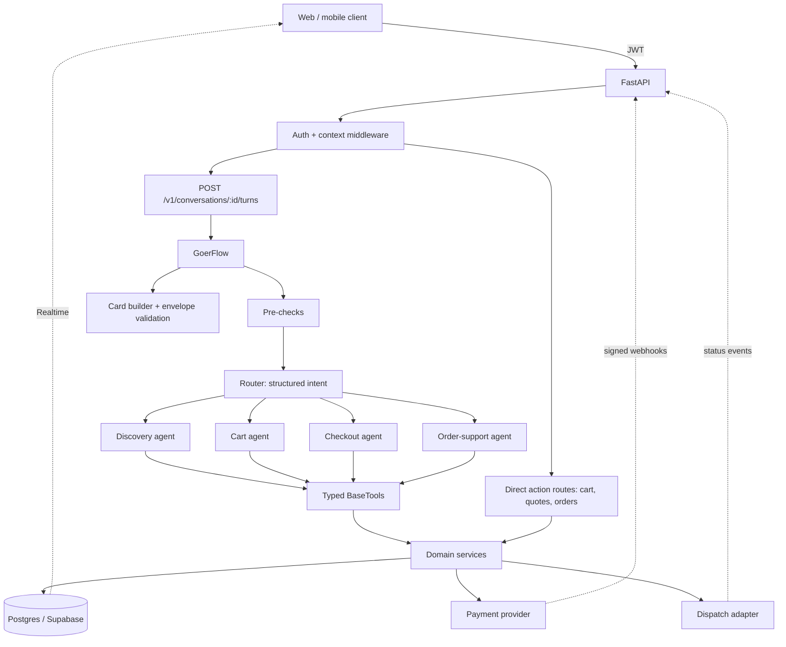
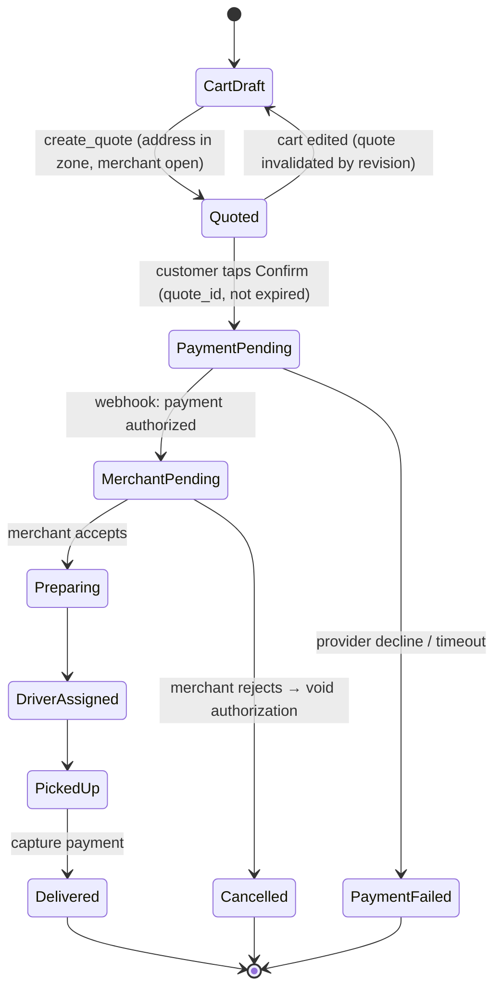

# Goer × LocalGo: Delivery App Architecture Plan

> **Status:** authoritative plan as of 2026-11-03. It supersedes
> `goer-agentic-architecture-plan.md` and
> `crewai-fastapi-localgo-architecture-plan.md`. Those files are kept for
> history only.

## 1. Goal

Turn Goer from a stateless menu-search chatbot into the conversational ordering
layer of **LocalGo**, a local restaurant delivery app. Customers should be able
to discover food, build a cart, check out, pay, and track or get support for
orders, all through one assistant. Every price, cart line, payment, and order
state must stay under deterministic backend control.

**Shape:** a modular monolith. It is one FastAPI deployable, with domain modules
inside it, a CrewAI Flow for conversation orchestration, and Postgres (Supabase)
as the system of record.

---

## 2. Where we are today (verified against the code)

| Area | Current state | Gap to fix |
|---|---|---|
| Flow | `GoerFlow` in `main.py`: `capture_turn` → `answer_turn` → `DiscoveryCrew` | A **new Flow is built per turn**, so there is no memory between turns. "Add 2 of those" cannot work. |
| Agent | One `discovery_agent`; model hardcoded in `agents.yaml` (`openai/gpt-4.1-mini`) | YAML `llm` overrides `MODEL` env, so the model is not configurable per environment |
| Tools | `search_menu` (substring on name), `get_menu` (whole merchant menu) | `get_menu` sends ~70 products plus option groups to the LLM, which is costly and slow. There is no product-detail, restaurant, or category tool. |
| Catalog | `data_menu.json`, 138 products, 2 merchants; re-read from disk on every call | No repository interface or caching; no restaurant records (hours, zone, fees) |
| API | `POST /v1/chat`, `/api/chat` → plain text | `user_id` is taken from the request body (not trusted), no conversation ID, no cards or actions |
| Tests | 7 unit/integration tests, 2 tool smoke tests | No offline Flow/agent tests with a stubbed LLM |

**Conclusion:** the deterministic tool boundary is right; keep it. The first
step is making conversations stateful and responses structured. Cart and
checkout come after that.

---

## 3. Core design decisions

### D1. Two paths into the domain: *chat turns* and *direct actions*

This is the most important decision for a delivery app.

```text
                   ┌─────────────── Chat turn (LLM) ───────────────┐
Customer text ───▶ │ Guard → Router → Specialist agent → tools     │──┐
                   └───────────────────────────────────────────────┘  │
                                                                      ▼
                                                            Domain services ──▶ Postgres
                                                                      ▲
Card button tap ─▶ Direct action API (no LLM) ────────────────────────┘
("Add to cart", "Confirm $34.12 order")
```

- **Language understanding** ("something spicy under $15 from Château Kabab")
  goes through the LLM.
- **Commitments** (add this exact item with these options, confirm this exact
  quote, cancel this order) can go through **typed REST actions** fired from
  cards, with no LLM involved. This makes them fast, cheap, and impossible for
  the model to mangle.
- The agent may *propose* mutations (for example, add to cart from chat), but
  **order placement and payment always require a direct action** that carries
  the `quote_id`. The model can never place an order on its own.

### D2. A cheap router, then one focused specialist per turn

Running a full multi-agent `Crew` on every turn is too slow and expensive for
chat. Each turn does the following:

1. **Deterministic pre-checks** (Python): size/rate limits, block card numbers
   and CVVs, and short-circuit action payloads.
2. **Router**: one structured LLM call that returns an
   `Intent(discovery | cart | checkout | order_support | smalltalk | handoff)`
   plus extracted slots. It uses a small, fast model.
3. **One specialist**: a single CrewAI `Agent` with only its own tools and a
   bounded `max_iter`.
4. **Response assembly** (Python): build cards from *tool results*, not from
   model prose, and validate the envelope.

Start with **one model for everything**. Split models only after evals show a
cost or latency win.

### D3. The server owns state; the model gets a compact snapshot

The model never holds cart or order truth. Each turn, the Flow loads a
**context snapshot** and passes it to the agent:

```text
cart: 2 lines, Al-Taib, subtotal $27.50 (rev 4)
active_order: none
last_shown_products: [chicken-shawarma, falafel-wrap, ...]   # resolves "those"/"the second one"
recent_turns: last 6 turns + rolling summary
```

### D4. Money is integer cents, end to end

Catalog, cart lines, option deltas, quotes, and orders all store integer
`*_cents` values with an ISO currency (`CAD`; normalize the current lowercase
`"cad"`). Formatting happens once, in Python, when cards are built. The LLM
never adds numbers.

### D5. Single-merchant carts (v1)

A cart belongs to one merchant. If the customer adds an item from another
merchant, they get a "start a new cart?" confirmation. This is standard delivery
UX and greatly simplifies quotes, dispatch, and fees.

---

## 4. Target runtime architecture



---

## 5. Repository layout (target)

This extends the current `src/goer_localgo/` tree. New items are marked `+`.

```text
src/goer_localgo/
  main.py                      # CLI entry points only (thin)
+ flow/
+   goer_flow.py               # GoerFlow: state, router, specialist dispatch, limits
+   state.py                   # GoerState, ContextSnapshot, Intent
+   persistence.py             # Postgres-backed Flow persistence
  crews/
    discovery_crew/            # existing (becomes discovery specialist)
+   cart_crew/
+   checkout_crew/
+   support_crew/
  tools/
    catalog_tools.py           # existing; add get_product, list_restaurants
+   cart_tools.py
+   checkout_tools.py
+   order_tools.py
    try-out-tools/             # one smoke test per tool (Rule 4)
  domain/
    catalog.py → catalog/      # repository interface + JSON and Postgres impls
+   cart/  checkout/  orders/  conversations/  money.py
+ schemas/                     # Pydantic: chat envelope, cards, actions, domain DTOs
+ integrations/
+   supabase.py  payments.py  dispatch.py
  api/
    main.py                    # app factory, middleware
+   routes/  chat.py  catalog.py  cart.py  checkout.py  orders.py  webhooks.py
  web/index.html               # renders known card types
tests/
  unit/  integration/
+ evals/                       # golden conversations scored offline
```

**Layering rule:** `api` and `tools` call `domain`, and `domain` calls
`integrations`. Domain code never imports CrewAI, and tools contain no business
logic. They validate arguments, call a service, and serialize compactly.

---

## 6. GoerFlow design

```python
class GoerState(BaseModel):
    id: str                          # == conversation_id (required for persistence)
    user_id: str                     # from JWT, never from the prompt
    turn: TurnInput | None
    intent: Intent | None
    snapshot: ContextSnapshot | None
    recent_turns: list[TurnSummary]  # capped (e.g. 6) + rolling summary
    last_shown_product_ids: list[str]
    response: ChatEnvelope | None
```

```text
@start  load_context      → load snapshot (cart, active order, recent turns)
@listen precheck          → deterministic guards; may short-circuit with a refusal
@router route_intent      → "discovery" | "cart" | "checkout" | "support" | "smalltalk"
@listen("discovery")  run_discovery   ┐
@listen("cart")       run_cart        │ each: Agent.kickoff with scoped tools,
@listen("checkout")   run_checkout    │ inputs = message + snapshot
@listen("support")    run_support     ┘
@listen(or_(...))     compose_response → build cards from tool results, validate, persist turn
```

**Limits per turn:** at most one specialist, `max_iter` around 4, about 6 tool
calls, a wall-clock timeout of about 20 seconds, and an output size cap. If a
limit is hit, return a graceful "I couldn't finish that; here's what I found"
response with partial cards.

**Persistence:** the conversation ID is the Flow state `id`. In development,
use CrewAI's default `@persist` (SQLite). In production, implement a
Postgres-backed persistence class. Verify the persistence API against the
pinned CrewAI version (`1.14.4`) before implementing.

**Tool results feed cards:** tools write their structured results into a
per-turn collector, and `compose_response` builds cards from that collector.
The client therefore shows exact catalog and cart data even if the model's
prose is imperfect.

---

## 7. Specialists and tool allowlists

| Specialist | Read tools | Mutation tools | Never allowed |
|---|---|---|---|
| Discovery | `list_restaurants`, `search_menu`, `get_menu_categories`, `get_product` | none | cart/order writes |
| Cart | `get_cart`, `get_product` | `add_cart_item`, `update_cart_line`, `remove_cart_line`, `clear_cart` | quotes, payment |
| Checkout | `get_cart`, `list_addresses` | `create_quote` (read-like; immutable) | `confirm_quote` and payment: **direct action only** |
| Order support | `list_orders`, `get_order`, `get_cancellation_options` | `request_cancellation` (policy-checked; requires a confirm action) | refunds, editing placed orders |

Tool rules:
- Each tool has a Pydantic `args_schema` with `extra="forbid"` and a compact
  output model with stable IDs. Return at most 10 items, and send option groups
  only from `get_product`.
- `user_id` is **injected server-side** into the tool instance at construction
  time. It is never a tool argument the model can set.
- Mutations carry `cart_revision` (optimistic concurrency) and an idempotency
  key derived from `turn_id + tool_call_index`.
- Errors return stable codes (`ITEM_UNAVAILABLE`, `OPTION_REQUIRED`,
  `CART_MERCHANT_MISMATCH`, `QUOTE_EXPIRED`, ...) that the agent can explain.

---

## 8. Domain model (Postgres)

```text
merchants(id, name, cuisine, address, lat, lng, hours jsonb, delivery_zone, min_order_cents, is_open_override)
products(id, merchant_id, name, description, category, price_cents, currency, image_url, allows_notes, is_available)
option_groups(id, product_id, name, min_select, max_select)
option_choices(id, group_id, name, price_delta_cents, is_available)

carts(id, user_id, merchant_id, revision, status, updated_at)
cart_lines(id, cart_id, product_id, quantity, selections jsonb, notes, unit_price_cents_snapshot)

addresses(id, user_id, label, line1, city, postal_code, lat, lng, instructions, is_default)

quotes(id, user_id, cart_id, cart_revision, address_id, subtotal_cents, delivery_fee_cents,
       service_fee_cents, tax_cents, tip_cents, total_cents, currency, expires_at, status)

orders(id, user_id, merchant_id, quote_id UNIQUE, total_cents, currency, address_snapshot jsonb,
       payment_status, fulfillment_status, delivery_status, created_at)
order_lines(id, order_id, product_id, name_snapshot, quantity, selections_snapshot, line_total_cents)
order_events(id, order_id, type, payload jsonb, source, created_at)   # append-only
payment_attempts(id, order_id, provider, provider_intent_id, status, amount_cents, created_at)

conversations(id, user_id, created_at, summary)
turns(id, conversation_id, role, text, cards jsonb, intent, trace_id, created_at)
tool_audit(id, turn_id, tool, args_redacted jsonb, result_code, latency_ms)
idempotency_keys(key, user_id, endpoint, response jsonb, created_at)
```

Row-level security keys every user-owned table on `user_id`. The JSON catalog
remains a **fixture repository** for development and tests.

---

## 9. Order lifecycle

Payment, fulfillment, and delivery are **separate status dimensions**, and every
transition is an appended `order_event`.



- Use **authorize on confirm, capture on delivery** (or on merchant accept, per
  business choice), so rejected orders never charge the customer.
- Only signed webhooks move payment status; client callbacks never do.
- Customers see status changes through Supabase Realtime on `orders` and
  `order_events`. The chat agent reads the same records and never infers status.

---

## 10. Chat API contract

`POST /v1/conversations/{conversation_id}/turns` (JWT required)

```json
{
  "conversation_id": "conv_123",
  "turn_id": "turn_456",
  "text": "Here are two shawarma options at Al-Taib.",
  "cards": [
    {"type": "product_list", "items": [
      {"product_id": "chicken-shawarma", "merchant_id": "al-taib",
       "name": "Chicken Shawarma", "price_cents": 1299, "currency": "CAD",
       "display_price": "$12.99", "has_required_options": true}
    ]}
  ],
  "actions": [
    {"type": "open_product", "label": "Choose options", "payload": {"product_id": "chicken-shawarma"}}
  ],
  "state": {"cart_id": "cart_9", "cart_revision": 4, "active_order_id": null},
  "trace_id": "tr_789"
}
```

**Card types (v1):** `restaurant_list`, `product_list`, `product_detail`
(with option picker), `cart_summary`, `address_picker`, `quote`,
`order_confirmation`, `order_tracking`, `support_handoff`.

**Direct action endpoints** (all mutations require an `Idempotency-Key`):

| Endpoint | Purpose |
|---|---|
| `POST /v1/conversations` | Create or resume a conversation |
| `GET /v1/catalog/restaurants`, `GET /v1/catalog/restaurants/{id}/menu`, `GET /v1/catalog/products/{id}` | Cacheable browsing |
| `GET /v1/cart`, `POST /v1/cart/lines`, `PATCH/DELETE /v1/cart/lines/{id}` | Cart (with `cart_revision`) |
| `GET/POST /v1/addresses` | Saved addresses |
| `POST /v1/checkout/quotes`, `POST /v1/checkout/quotes/{id}/confirm` | Quote and confirm (this creates the order and payment intent) |
| `GET /v1/orders`, `GET /v1/orders/{id}`, `POST /v1/orders/{id}/cancellation` | Orders |
| `POST /v1/webhooks/payments`, `POST /v1/webhooks/dispatch` | Signed provider events |

Keep `/api/chat` as a deprecated alias for the current web UI until it migrates.

---

## 11. Security and safety

- **Identity:** verify the Supabase JWT in middleware and derive `user_id`
  server-side. Remove `user_id` from `ChatRequest`.
- **Ownership:** every service call checks that `resource.user_id == ctx.user_id`.
  Cross-user IDs return 404, not 403.
- **Payments:** card data only ever goes through the provider's hosted fields or
  tokenization. The pre-check regex rejects PAN- or CVV-looking strings in chat
  before they reach the LLM or logs.
- **Prompt injection:** treat product descriptions, addresses, and notes as
  untrusted data. Tools cannot be added at runtime. Consequential actions need
  a direct-action confirmation, so an injected instruction cannot place an
  order.
- **Secrets:** keep the service-role key only inside `integrations/`, never in
  agent context. Redact tokens, full addresses, and payment IDs in logs.
- **Abuse:** per-user rate limits on turns, a max message length (4,000
  characters already enforced), and caps on cost per conversation.

---

## 12. Observability and evaluation

- **Tracing:** one `trace_id` per turn, propagated to the router call, agent
  run, tool calls, DB writes, and provider calls. Use CrewAI event listeners
  together with OpenTelemetry, or Langfuse for LLM traces.
- **Metrics:** p50 and p95 turn latency, tokens and cost per turn, router
  accuracy, tool error codes, turns until cart, quote-to-order conversion, and
  duplicate-mutation rejections.
- **Evals (`tests/evals/`):** golden conversations scored offline on each
  prompt or model change:
  - grounding: every product name and price in the text exists in tool results;
  - routing: intent matches the label;
  - reference resolution ("the second one", "make it two");
  - adversarial: injection in notes, cross-user order IDs, a stale quote, and a
    pasted card number.

---

## 13. Testing strategy (extends Rule 4)

| Layer | What | LLM? |
|---|---|---|
| Domain unit tests | pricing, option validation, cart revision conflicts, quote expiry, state transitions | none |
| Tool smoke tests (`try-out-tools/`) | valid call, not-found, invalid args, ownership failure | none |
| Flow tests | routing, limits, card assembly, persistence across turns | **stub `BaseLLM`** returning scripted tool calls |
| API integration | auth, idempotency replay, webhook signature, envelope schema | stub LLM + fixture repo |
| Evals | quality on real model | real model, run on demand or nightly, not in unit CI |

---

## 14. Phased roadmap

Each phase is shippable, and each item is a small commit (Rule 1).

### Phase 0: Harden the current prototype ✅ done 2026-11-03
- Read the model from the `MODEL` env (remove the hardcoded `llm` in
  `agents.yaml`).
- Cache the catalog in memory behind a `CatalogRepository` interface
  (JSON implementation).
- Compact tool outputs: `get_menu` returns categories plus names and prices
  only, and option groups move to a new `get_product`.
- Normalize currency to `CAD`; add a `money.format_cents()` helper.
- Add stub-LLM Flow tests.

**Exit:** existing behavior is preserved, there are fewer tokens per turn, and
tests run fully offline.

### Phase 1: Stateful conversations and the structured envelope
- `conversation_id` becomes the Flow state `id`; add `@persist` (SQLite in dev),
  recent turns, and `last_shown_product_ids`.
- Add `ChatEnvelope` with `product_list` and `product_detail` cards built from
  tool results.
- Add the `POST /v1/conversations` and `/turns` endpoints, and update the web UI
  to render cards.
- Add `list_restaurants` and `get_menu_categories`; improve search (category
  and description matching, plus a simple fuzzy match).

**Exit:** a multi-turn conversation like "what's at Château Kabab?" → "tell me
about the second one" works.

### Phase 2: Persistence and auth
- Supabase Postgres schema (catalog, conversations, turns, tool audit), a
  Postgres catalog repository, and a seed script from `data_menu.json`.
- JWT middleware and RLS; remove the client-supplied `user_id`.
- A Postgres-backed Flow persistence class.

**Exit:** conversations survive restarts and are isolated per user.

### Phase 3: Cart
- Cart domain service (single merchant, option validation, revisions), cart
  REST routes, cart tools, a cart specialist, and a `cart_summary` card.
- Router gains the `cart` intent; "add two of those" resolves via the snapshot.

**Exit:** a cart built by chat or by buttons is identical, and concurrent edits
are rejected cleanly.

### Phase 4: Checkout and payment
- Addresses, a delivery-zone check (radius from the merchant to start),
  merchant hours, and a minimum order.
- Quote service (subtotal, options, delivery fee, tax, tip) with an immutable,
  expiring `quote` card.
- Confirm is a **direct action**: create the order and a payment intent
  (authorize), with a signed webhook to update payment status.

**Exit:** an end-to-end sandbox order works, retried confirms never create a
duplicate order, and no card data appears in logs.

### Phase 5: Orders, dispatch, and support
- Order state machine with an `order_events` append log, a merchant
  accept/reject adapter, a dispatch adapter, and Realtime tracking.
- Order-support specialist: status, history, policy-checked cancellation, and
  human handoff card.

**Exit:** the full lifecycle works in staging, including rejection and refund
paths.

### Phase 6: Production readiness
- Tracing dashboards, an eval suite in CI (nightly), rate limits, streaming
  turns (SSE), load testing, and a gradual rollout behind a feature flag.

---

## 15. Open decisions (need owner input)

1. **System of record:** is there an existing LocalGo Supabase project and
   schema for merchants, menus, and orders, or does Goer's Postgres become
   authoritative?
2. **Payment provider:** Stripe is assumed. When should capture happen: at
   merchant accept or at delivery?
3. **Tax rules:** which jurisdiction(s) apply? Tax rates must come from
   configuration, not code constants.
4. **Delivery fees and zones:** use flat fee plus radius for v1, or
   distance-based pricing?
5. **Dispatch:** is it an in-house driver app (existing LocalGo dispatch
   endpoints) or a third party?
6. **Anonymous mode:** allow guest discovery without login, with sign-in
   required at cart or checkout?
7. **Model:** keep `openai/gpt-4.1-mini` for all roles, or use a smaller model
   for the router once evals exist?
